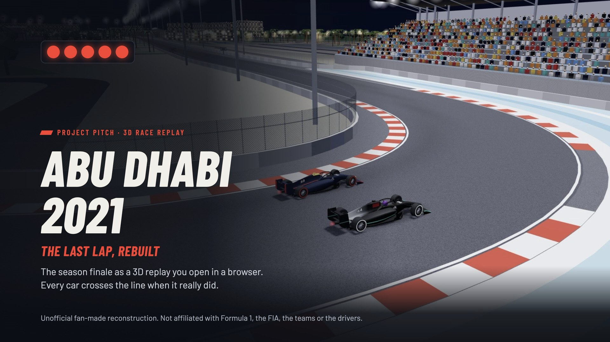
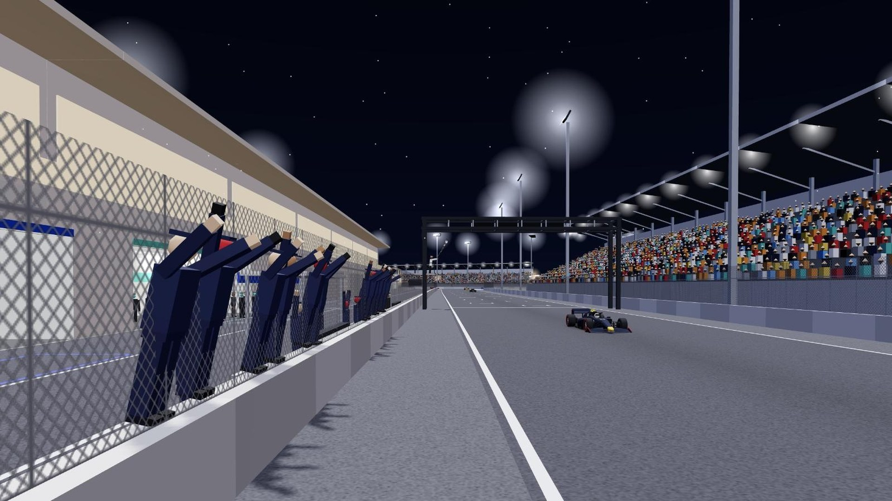
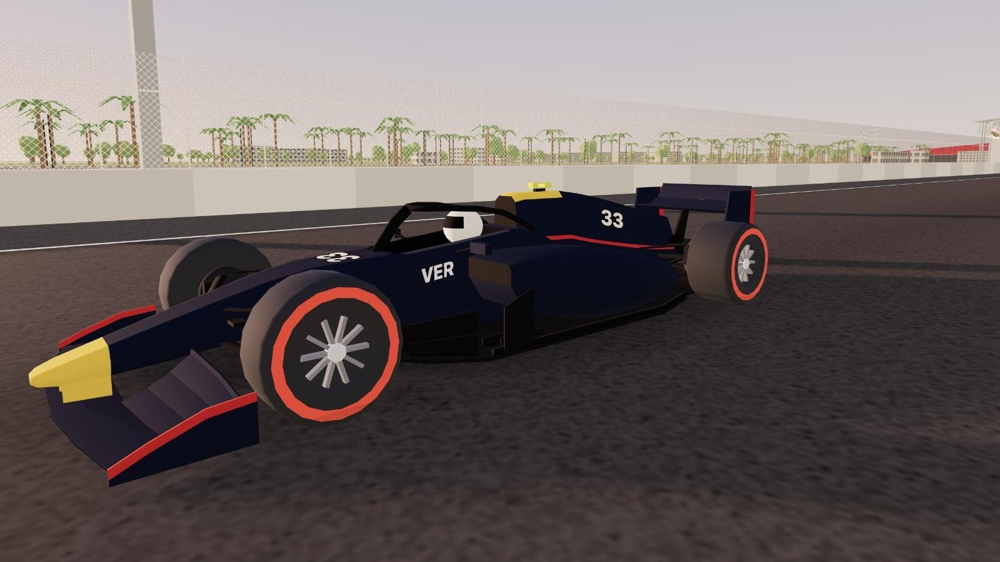
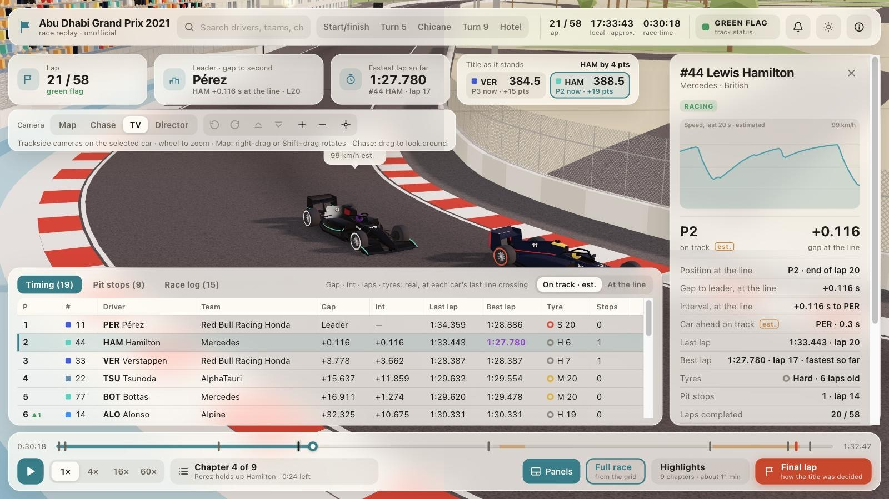
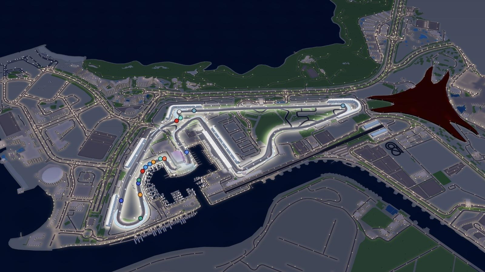
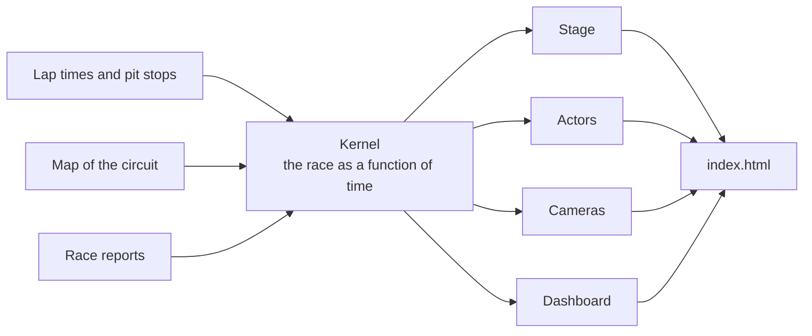

<div align="center">

[Watch it live](https://kamal-abdullayev.github.io/f1-abu-dhabi-2021/) · [Slides](Abu%20Dhabi%202021%20Presentation.pdf) · [User guide](docs/user-guide.txt)

</div>

## The race

The 2021 season came down to the final race. After 21 rounds Max Verstappen and Lewis Hamilton were on exactly the same points tally (369.5) - that had only happened once before, in 1974. So at the final race on 12th December at Yas Marina the maths were simple - finish ahead of the other man and you're world champion.
For most of the evening it was Hamilton's night. He took the lead at the start and still had it with six laps to go. Then a car hit the wall at Turn 14 and the safety car came out. Verstappen pitted for fresh softs. Hamilton stayed out on his hard tyres which had already done about 40 laps. The safety car came in at the end of lap 57 which left one lap of racing.
Verstappen went down the inside at 5 and took the lead, Hamilton came back at him on the straights that follow but couldn't get past. Verstappen won by 2.256 seconds. First world title for Verstappen.
People still argue about how that safety car period was run. We don't take a side on it at all. We just wanted to go and watch that lap again from any angle we wanted.
## What this is

A replay, not a simulation. A simulation gives you a different race each time. This gives you the race that happened: all 998 lap times come from the race record, so the order and the gaps at the line are the real ones. Where a car is between two line crossings is modelled, and the app labels those figures "est."

<table>
<tr>
<td width="50%"></td>
<td width="50%"></td>
</tr>
<tr>
<td align="center"><b>The finish</b><br>The crew runs to the pit wall as the car takes the flag</td>
<td align="center"><b>The cars</b><br>Built in code, in each team's colours</td>
</tr>
<tr>
<td></td>
<td></td>
</tr>
<tr>
<td align="center"><b>The dashboard</b><br>Live timing, tyres, pit stops and the title as it stands</td>
<td align="center"><b>The circuit</b><br>From golden hour to floodlights, on the real clock</td>
</tr>
</table>

## Features

| | |
|---|---|
| **Final lap** | Lap 58 at real speed with a scripted camera sequence. About 2.5 minutes. |
| **Highlights** | The nine moments that shaped the race. About 11 minutes. |
| **Full race** | All 90 minutes, or the whole race in 90 seconds at 60×. |
| **Four cameras** | Free map, chase with onboard view, 29 trackside TV cameras, and a director for the finale. |
| **Live dashboard** | Timing for all 19 cars, tyre stints, 29 pit stops, a race log, and who would be champion right now. |
| **Jump anywhere** | The race is a function of time, so seeking forwards or backwards is instant. |
| **Phone layout** | The same file folds into a bottom sheet on a narrow screen. |

## Guide

1. Open `index.html` in a current browser. It needs an internet connection to load the 3D library.
2. Press **Final lap** at the bottom right.
3. Try the camera buttons at the top left. In Chase, drag to look around the car.

The timeline at the bottom works like a video player. Click a car to follow it, and watch the "Title as it stands" card on the last lap.

Every control and gesture is listed in the [user guide](docs/user-guide.txt).

## Technical part



- **Kernel.** Give it a race time and it returns every car's position. Nothing is simulated step by step.
- **Verified.** The 58 lap times add up to the official race time, 1:30:17.345, and the running order matches the lap chart on every lap.
- **Generated.** Every shape on screen is built in code. There are no model files and no images.
- **Light.** The scene follows the real evening: the race starts in daylight and ends under floodlights.
- **One dependency.** Three.js, loaded from the web. No server, no build step to run it.

```
index.html         the app
docs/              user guide, developer notes, screenshots
source/build/      source parts and the build script
source/out/        data packs the page embeds
source/scripts/    scripts that fetched and processed the data
source/deck/       source of the slides
```

To change the code, see [docs/DEVELOPMENT.md](docs/DEVELOPMENT.md).

**Known gaps:** the track is flat, all teams share one car shape, and it has not been tested on Safari, Firefox or a physical phone yet.

## Credits

- Timing data: [Jolpica F1 API](https://github.com/jolpica/jolpica-f1) (CC BY-NC-SA 4.0)
- Map data: © [OpenStreetMap](https://www.openstreetmap.org/copyright) contributors (ODbL)
- Tyre stints: RaceFans · 3D library: Three.js

---

<div align="center">
<sub>Unofficial fan project, made for fun, not for money. Not affiliated with Formula 1, the FIA, the teams or the drivers.<br>No logos or sponsor artwork are used. Non-commercial use only. More in <a href="NOTICE.md">NOTICE.md</a>.</sub>
</div>
